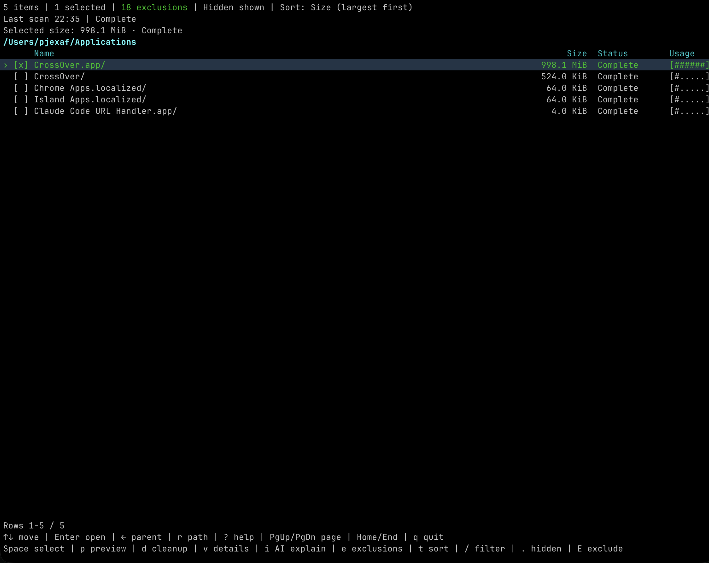
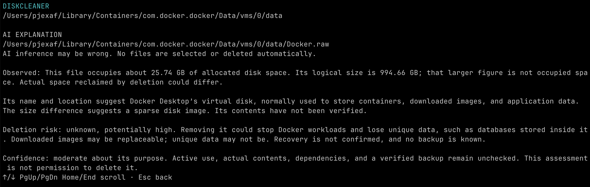

# DiskCleaner

A macOS disk analyzer and cleanup tool with a terminal interface and optional AI-powered explanations through installed Codex. See what takes up space, review your selection, and move files to Trash or delete them permanently.

AI explanations can help identify a highlighted file or folder and assess deletion risk while stating uncertainty. Press `i` to review the read-access disclosure and confirm before the request runs. A compatible, signed-in Codex CLI is required; no separate API key is needed.

## Screenshots

**Main interface**



**AI explanation**



## Download v0.1.0-beta.3 prerelease

[Download the v0.1.0-beta.3 prerelease from GitHub](https://github.com/Gogn/DiskCleanerMacOS/releases/tag/v0.1.0-beta.3).

- `diskcleaner_v0.1.0-beta.3_darwin_arm64.tar.gz` — Apple Silicon (M-series)
- `SHA256SUMS` — archive checksums

Download the arm64 archive and `SHA256SUMS`. Run `shasum -a 256` on the archive and compare its hash with the matching line in `SHA256SUMS`, then extract it in Terminal:

```sh
shasum -a 256 diskcleaner_v0.1.0-beta.3_darwin_arm64.tar.gz
tar -xzf diskcleaner_v0.1.0-beta.3_darwin_arm64.tar.gz
./diskcleaner
```

Beta.3 is an Apple Silicon-only release. Each archive contains `diskcleaner`, `LICENSE`, and `THIRD_PARTY_NOTICES.txt`; Go is not required. macOS 26 and successful real Trash movement remain unverified. Intel is outside this release's scope.

The app is not Developer ID-signed or notarized, so macOS may show a security warning. Verify the official checksum before opening. If you still choose to proceed, use Apple's standard [Open Anyway flow](https://support.apple.com/en-us/102445) for this download; do not disable Gatekeeper globally.

See the [release and source validation status](docs/validation.md#published-prerelease-and-current-source) for the exact source revision and verification evidence for each release.

## Build and run

Requires Go 1.26 or newer.

Maintainers: see [release archive instructions](docs/releasing.md) to build prerelease archives.

```sh
go mod download
go build -o diskcleaner ./cmd/diskcleaner
./diskcleaner
```

The app opens directly in the filesystem browser at your home directory, without scanning or opening the exclusion editor. To start elsewhere:

```sh
./diskcleaner -root "$HOME/Downloads"
```

## Quick start

1. Browse with the arrows or Enter; use `r` to paste or type a directory path.
2. Optionally edit global exclusions with `e`, then press `s` and Enter to scan.
3. Select items with Space; `p` opens an optional dry run.
4. Press `d`, review paths and mode, then Enter to confirm. Trash is the default; `o` changes the mode.

| Key | Action |
| --- | --- |
| Enter / ← | Open the highlighted folder / go to its parent |
| `r` | Open an empty path field; paste a path, then Enter |
| `s` / Space | Scan / select an item |
| `i` | AI explanation, after an explicit read-access confirmation |
| `e` / `t` / `/` | Global exclusions / sorting / name filter |
| `p` / `d` | Optional preview / cleanup confirmation |
| `?` / `q` | Help / quit from the browser |

Opening folders never starts a scan or cleanup. Sizes are last-scan snapshots, not live measurements. Saved sizes may be restored after restarting the app when the folder and entries still match, but files may have changed since the scan; press `s` to refresh before relying on them. Cleanup affects only manually selected items after confirmation; checks and deletion are not atomic, and cancellation cannot undo changes already made. A Trash failure never falls back to permanent deletion.

See the [user guide](docs/usage.md) for all keys, path entry, saved scan results, exclusions, AI read access and cleanup safeguards. Settings are saved in `~/Library/Application Support/DiskCleaner/config.json`; scan snapshots are stored in the private SQLite database `scan-cache.sqlite` beside it.

## Documentation and development

- [Documentation index](docs/README.md) — current references, historical records and proposals.
- [User guide](docs/usage.md) — detailed behavior and controls.
- [Design](docs/design.md) — behavior and protection rules.
- [Validation status](docs/validation.md) — recorded checks and remaining release gates.
- [Release guide](docs/releasing.md) — build and verify a new prerelease.

Current local verification is recorded separately from published-release evidence; macOS 26 and real Trash movement remain unverified. Intel is outside the beta.3 release scope.

For scan-cache iteration, run `./scripts/check.sh quick`. It runs focused `internal/ui/state` tests whose names match `SQLite|ScanCache|Cleanup`. For changes in other packages, run the focused package test command while iterating.

Run `./scripts/check.sh full` for broad changes and before merging or releasing. It runs `go test -race ./...`, `go vet ./...`, and builds `./cmd/diskcleaner`. Documentation-only and small cosmetic changes do not require repeating the full checks unless they affect risk or a release gate.

## License

[GPL-3.0-only](LICENSE). Dependency licenses are in [THIRD_PARTY_NOTICES.txt](THIRD_PARTY_NOTICES.txt).
